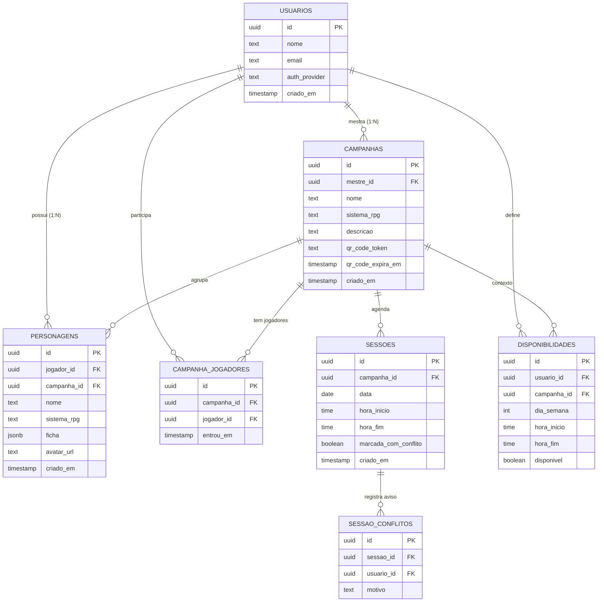

# Modelo de Dados (DER) — NotRPGpédia

## Diagrama (Mermaid)

## Decisões de modelagem

- **Disponibilidade é entidade própria** (não embutida em Sessão): ela representa a agenda recorrente do jogador por dia da semana/horário, independente de qualquer sessão específica. A Sessão referencia a Campanha; o cálculo de conflito cruza `disponibilidades` dos jogadores da campanha com a data/hora da sessão no momento da marcação.
- **`ficha` em JSONB**: como o formulário varia por sistema de RPG (D&D 5e, Tormenta20, Ordem Paranormal), os campos específicos ficam em JSONB dentro de `personagens`, evitando 3 tabelas diferentes. `sistema_rpg` indica qual schema de validação usar no backend.
- **`campanha_jogadores`** é a tabela de junção do N:N entre `usuarios` (como jogadores) e `campanhas`.
- **`sessao_conflitos`** guarda o histórico de quem estava em conflito quando o mestre decidiu marcar mesmo assim (auditoria do aviso).
- **`qr_code_token` + `qr_code_expira_em`**: token de acesso à campanha com expiração configurável (ex. 24h), validado no endpoint de entrada.

## Entidades que contam para a métrica

4 entidades de negócio (além de Usuário): **Campanha, Personagem, Sessão, Disponibilidade**. `campanha_jogadores` e `sessao_conflitos` são tabelas de apoio/junção.
